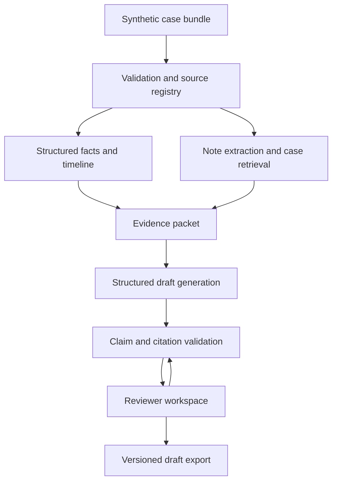

# Explainable NLP Assistant for Suspicious Activity Report Drafting

**BITS Pilani WILP final-semester project — proposed project plan, v0.1**  
Prepared: 29 October 2026  
Working repository name: `sar-drafting-assistant`  
Status: proposal for supervisor review; implementation has not started.

## 1. Executive summary

Investigators must transform transaction records, alert descriptions, customer profiles, and case notes into clear narratives. This requires reconciling dates and amounts, distinguishing observations from allegations, identifying gaps, and preserving the evidence behind each statement. A fluent language-model response can still invent details, omit contradictory evidence, or attach a citation that does not actually support its claim.

This project will implement and evaluate an evidence-grounded drafting assistant using information extraction, case-scoped retrieval-augmented generation (RAG), structured generation, deterministic transaction calculations, and claim-level validation. It will produce a draft narrative, an ordered transaction timeline, missing-information questions, and a clickable evidence trail. A reviewer can inspect, edit, reject, and export a versioned draft.

The research question is whether this combination improves factual consistency, evidence coverage, and completeness compared with template-based drafting and simpler LLM baselines. All evaluation will use synthetic case records. The system will not decide whether a crime occurred, recommend filing, or submit a report. Every output remains explicitly labelled a human-review draft, including after review.

## 2. Planning assumptions and decisions to confirm

| Item | Working assumption | Confirmation needed |
|---|---|---|
| Duration | 16 weeks, approximately 10–12 hours/week | Actual semester dates and submission deadlines |
| Staffing | One student with supervisor guidance | Team size and contribution rules |
| Academic format | Synopsis, interim demonstration, dissertation/report, final demo and viva | Current programme handbook, template, page limits and assessment rubric |
| Domain | Retail/small-business banking case narratives | Supervisor's preferred banking use case |
| Jurisdiction | SAR terminology retained from the brief; educational narrative schema | Whether to use US SAR context or India-focused STR terminology |
| Data | Entirely synthetic, English, CSV/JSON and plain-text notes | Any permitted additional dataset |
| Compute | Ordinary development laptop plus a capped model API budget | Available RAM/GPU and approved model provider |
| Review | Seek two independent reviewers for a small evaluation subset | Access to an AML/compliance expert |

These are project design choices, not statements of BITS Pilani WILP requirements. Confirm academic deliverables before adapting this document into a formal synopsis.

**Jurisdiction boundary:** FIU-India uses Suspicious Transaction Report (STR) terminology [R3]. FinCEN SAR guidance is a useful narrative-design reference [R1–R2], but the prototype will not claim compliance with either filing regime. Choose one terminology and narrative template in week 1. Do not mix thresholds, deadlines, or official filing formats. The software does not need regulatory thresholds to perform evidence-grounded drafting.

## 3. Problem statement and users

Given a synthetic case bundle containing an alert, customer/account information, transactions, and investigator notes, generate a concise narrative that faithfully reflects the supplied evidence. Each material factual claim must link to supporting source records or a reproducible computation. Missing, uncertain, and conflicting information must remain visible.

Primary user: an investigator reviewing an already-created case. Secondary user: a supervisor checking narrative quality and traceability. Research user: the student running controlled experiments and inspecting errors.

The input alert is a supplied observation, not proof of wrongdoing. The assistant must preserve attribution: “The alert records…” or “The investigator noted…” rather than silently converting a note into an established fact.

## 4. Objectives and research questions

1. Define a versioned case schema and evidence model with stable source identifiers.
2. Extract entities, dates, transactions, and attributed observations from notes.
3. Construct an accurate timeline and compute amounts independently of the LLM.
4. Retrieve relevant case evidence while preventing cross-case contamination.
5. Generate structured narratives with claim-to-evidence mappings.
6. Surface missing details and contradictions without filling gaps by invention.
7. Provide a review interface and maintain draft/version provenance.
8. Compare factuality, citation quality, completeness, reviewer effort, latency, and cost across baselines.

**RQ1:** Does an evidence-constrained pipeline reduce unsupported material claims relative to direct LLM drafting and basic RAG?

**RQ2:** Does claim validation improve citation support while retaining sufficient narrative completeness?

**RQ3:** Does explicit missing-information detection reduce unjustified assertions in incomplete or contradictory cases?

**RQ4:** Does the evidence interface help reviewers correct drafts more accurately or quickly than reviewing a plain draft?

Hypotheses are directional and must be tested. Improvements are not assumed results. A finding that the simpler baseline works equally well on small case bundles is a legitimate outcome.

## 5. Scope and exclusions

### Required MVP

- Import one synthetic case bundle with schema validation and actionable errors.
- Preserve original source records, versions, hashes, and record/span references.
- Extract note facts with source attribution and unresolved-entity handling.
- Display a timeline, per-currency totals, and transaction status.
- Generate a structured draft containing evidence references.
- Show missing information and contradictions beside the draft.
- Let a reviewer inspect evidence, edit text, and mark review decisions.
- Revalidate changed claims and invalidate stale review status after edits.
- Export a draft narrative, timeline, and evidence appendix in Markdown/JSON.
- Run reproducible experiments and save case-level evaluation results.

### Optional extensions, only after MVP evaluation works

Hybrid retrieval/reranking, a second model comparison, PDF export, a lightweight relationship graph, and a separate UI usability experiment. Each extension must answer a research question or improve the demonstration.

### Out of scope

Actual regulatory filing, production bank integration, real customer data, autonomous crime/suspicion classification, sanctions screening, OCR of arbitrary scanned documents, multilingual support, large-scale model training, production multi-tenancy, and autonomous multi-agent investigation. No fine-tuning is required for the core project.

## 6. Background and defensible contribution

FinCEN and FFIEC guidance motivates a coherent, chronological account covering the parties, activity, timing, location, basis for concern, and method [R1–R2]. This project uses those ideas to design an educational completeness checklist, not an official filing form.

Lewis et al. provide a foundation for retrieval-augmented generation [R4]. Gao et al.'s ALCE work motivates treating correctness and citation quality as separate evaluation dimensions [R5]. A retrieved passage or printed citation alone is not evidence that a generated statement is supported.

The proposed contribution is an evaluated combination of structured facts, deterministic calculations, attributed notes, constrained evidence selection, and claim-level review for synthetic financial-case narratives. Do not claim a new foundation model, a new RAG algorithm, or the first SAR assistant without a broader literature review.

During weeks 1–2, extend the literature matrix to 8–12 directly relevant sources covering information extraction, attribution/citation evaluation, factuality, human review, and financial narrative generation. Record each source's method, dataset, limitations, and the precise design decision it informs. Separate primary research from vendor demonstrations.

## 7. Proposed architecture

Use a modular monolith to keep the semester scope manageable. The following diagram describes module boundaries, not separate deployed services.



**Suggested stack:** Python/FastAPI with typed schemas for the backend; PostgreSQL with a vector extension for records and retrieval; a small React/TypeScript frontend; pytest for backend checks and a browser test for the review workflow; Docker Compose for repeatable local setup. Pin compatible versions during implementation after checking official documentation. SQLite plus a local vector index is a fallback if database setup threatens the schedule.

Use one instruction-following LLM through a provider adapter. Select an affordable model after a development-set pilot, considering structured-output reliability, context limits, latency, and cost. A local model is optional if hardware permits. Model/provider selection and pricing remain unconfirmed. A single explicit pipeline is sufficient; a workflow framework is optional.

Keep task orchestration synchronous initially. Add a background job only if generation time causes a demonstrated usability problem. Do not add Kubernetes or distributed queues to the MVP.

## 8. Data and provenance design

| Entity | Key fields |
|---|---|
| Case | case_id, synthetic flag, alert reference, profile, schema version |
| Source | source_id, case_id, type, version, content hash, original content |
| Transaction | transaction_id, source record pointer, timestamp/timezone, direction, amount as decimal, currency, counterparty, status |
| Extracted fact | fact_id, entity/attribute/value, exact source span, attribution, extraction status |
| Computation | computation_id, input transaction IDs, operation, filters, currency, result, algorithm version |
| Claim | claim_id, draft version, text span, claim type, evidence IDs, support status |
| Gap/conflict | item_id, field/claim, reason, related sources, suggested reviewer question |
| Draft/run | draft_id, case version, model/version, prompt hash, retrieval config, timestamp, status |
| Review | draft version, reviewer ID, decision, comment, timestamp, changed claim IDs |

Source references must resolve to an exact JSON pointer, CSV record identity, or text span plus source version. Line numbers alone can drift. Amounts use decimal arithmetic. Missing values are explicit nulls with reasons, not invented placeholders that look like facts.

Treat source content as untrusted input. Instructions embedded in notes are data, never system instructions. Evidence IDs must belong to the active case and version. Guidance documents live in a separate collection: they may inform style, but cannot support a claim about a customer.

## 9. Pipeline design

### 9.1 Ingestion and normalization

Validate required identifiers and data types. Reject duplicate primary IDs and ambiguous currency/amount formats. Preserve raw inputs before normalization. Retain timezone metadata and flag absent or ambiguous dates. Do not silently assume an order for date-only events.

### 9.2 Information extraction

Read structured fields directly. Use rules and schema-constrained extraction for notes: parties, dates, references, stated purpose, investigator observations, customer explanations, and unresolved questions. Every extracted fact carries a source span and attribution. Validate dates and numeric values against the source. Uncertain entity matches remain unresolved instead of merging people with similar names.

### 9.3 Timeline and calculations

Build the timeline from validated records. Separate completed, attempted, reversed, and cancelled transactions. Define the aggregation window and inclusion policy. Compute totals by currency and direction, never sum mixed currencies without an explicit exchange-rate record. Distinguish gross activity from net movement. Store the input IDs and calculation so a reviewer can reproduce each derived claim.

### 9.4 Retrieval

Use case-filtered lexical retrieval as an initial baseline and dense retrieval as the RAG implementation. Compare hybrid retrieval only if time allows. Split long notes at paragraph boundaries while preserving stable offsets. Tune chunk size and top-k on the development set.

Critical structured facts and computed summaries enter the evidence packet directly rather than relying on vector search to recover them. Retrieve supporting and contradictory note excerpts. If the packet exceeds context limits, use explicit section budgets and surface truncation; never silently discard required evidence. Small cases may fit entirely in context, which is why a full-context baseline is required.

### 9.5 Structured generation

Ask the model for a typed draft containing sections, atomic claims, evidence IDs, attributed interpretations, and unresolved items. Allow evidence IDs only from the supplied packet. Sections cover case context, relevant profile, chronological activity, documented reason for review, actions already recorded, and unresolved information. Never invent investigative actions or characterize a person as guilty.

### 9.6 Validation and handling failure

Run schema checks, evidence-ID existence checks, case-boundary checks, amount/date consistency checks, and attribution checks. For an aggregate, validate the calculation and all input references. Semantic support requires more than string matching; use a rubric and optionally an entailment model/LLM judge as a screening aid, calibrated against human labels.

Statuses: supported, partially supported, unsupported, contradicted, or needs review. These are operational labels, not probabilities of truth. Limit automatic repair to one pass and retain both versions. If validation still fails, show the unresolved issue or fall back to an extractive/template draft. Do not hide failures by removing all substantive content.

### 9.7 Review and export

Display draft text, source evidence, and gaps together. Clicking a claim opens its exact source and calculation where applicable. A reviewer can accept, edit, reject, or add a note. Any edit creates a new version and triggers validation for changed claims; source changes invalidate affected evidence links. Export includes unresolved flags, review status, generation metadata, and the label “Human-review draft — not a filing or determination of wrongdoing.”

## 10. Explainability and example

Explainability means inspectable source support and reproducible derivation, not disclosure of a model's hidden reasoning. Retrieval similarity is not factual confidence, and citation presence is not citation correctness.

Synthetic input example:

| Source ID | Content |
|---|---|
| TX001 | 4 March 2026, completed incoming transfer, USD 4,000 |
| TX002 | 5 March 2026, completed incoming transfer, USD 3,500 |
| TX003 | 6 March 2026, completed outgoing transfer, USD 7,000, counterparty C02 |
| NOTE001 | Investigator records that the business purpose is not yet confirmed |

Acceptable draft: “Two completed incoming transfers totalling USD 7,500 were recorded on 4–5 March 2026 [CALC001: TX001, TX002]. A completed outgoing transfer of USD 7,000 to C02 was recorded on 6 March 2026 [TX003]. The investigator noted that the business purpose had not yet been confirmed [NOTE001].”

Gap: “What documentation establishes the purpose of these transfers?”

Unacceptable inference: “The customer laundered USD 7,500.” The records do not establish that conclusion. Also do not claim that the incoming funds funded the outgoing transfer without sufficient balance/flow evidence.

## 11. Synthetic dataset and annotation

Target **120 independently authored scenario families**, with **60 development, 20 validation, and 40 held-out test cases**. These names describe prompt/retrieval development, not foundation-model training. If annotation capacity is insufficient, reduce the total before test-set freeze and report the limitation.

Use six strata of 20 cases each, split 10/3/7, 10/3/7, 10/3/7, 10/3/7, 10/4/6, and 10/4/6 across development/validation/test respectively:

1. Repeated credits followed by outgoing transfers.
2. Activity differing from a documented customer profile.
3. Multiple counterparties and ambiguous transaction purposes.
4. Apparently unusual activity with documented benign explanations.
5. Missing identities, purposes, or temporal details.
6. Contradictory notes, corrections, duplicates, and reversals.

These are narrative stress-test categories, not labels of criminal activity. Include attempted transactions, mixed currencies, date ambiguity, large cases, irrelevant notes, and prompt-injection text as tags across categories.

Create structured records and gold facts first using deterministic scripts and fixed seeds. Author or paraphrase notes second. A human verifies that each note preserves intended facts and ambiguity. Do not let the generation model serve as the sole author and evaluator of its own test data.

Gold labels include atomic material facts, acceptable evidence sets, expected calculations, required/optional narrative items, missing fields, contradictions, and statements that must not be asserted. A single gold prose narrative is insufficient because many valid drafts are possible.

Keep template families, near-duplicates, paraphrases, and counterfactual variants in the same split. Freeze test data before prompt tuning. Keep gold annotations outside the retrieval corpus. Have two annotators independently label a subset, resolve disagreements, and report agreement. Seek supervisor/domain review of scenario realism before freezing the benchmark.

## 12. Experimental design

| System | Purpose |
|---|---|
| B0: deterministic template | Establish factuality and completeness without an LLM |
| B1: direct full-context LLM | Measure the value of extra pipeline components when cases fit context |
| B2: basic RAG with citations | Separate retrieval/citation prompting from validation |
| P: proposed pipeline | Structured evidence, calculations, gap handling, and claim validation |

Use the same model, output budget, schema expectations where applicable, and cases for B1/B2/P. Document input truncation and retrieval budgets. B0 is an engineering baseline, not a compute-matched comparison. Measure raw and post-repair output separately so validation gains are interpretable.

Primary endpoint: per-case proportion of material claims fully supported by evidence. Secondary endpoints: citation support, gold-fact completeness, gap detection, numerical accuracy, and reviewer corrections. Report both factuality and completeness to penalize empty or evasive drafts.

Run each LLM condition three times per test case where cost permits: 40 × 3 systems × 3 runs = 360 generation runs, plus verifier/repair calls. Do not count repeated outputs from the same case as independent cases. Aggregate repetitions within case and compute paired case-level differences with bootstrap confidence intervals. Report category-level errors and all failures, not just successful runs.

Ablations, subject to budget: remove semantic validation; remove explicit gap/conflict handling; replace computed summaries with model-derived summaries. Use identical held-out cases and settings. Do not redesign the system after inspecting test errors and then reuse that set as an untouched test.

## 13. Metrics and acceptance criteria

| Metric | Operational definition | Proposed target |
|---|---|---|
| Factual consistency | Fully supported material claims / all material claims | ≥95% on held-out drafts |
| Citation coverage | Material claims with a citation / all material claims | 100% for export-ready draft claims |
| Citation support precision | Claim-citation links that genuinely support the attached atomic claim / all links | ≥95% |
| Complete evidence support | Material claims whose cited evidence jointly supports the whole claim / all material claims | ≥95% |
| Gold-fact completeness | Required gold facts correctly represented / all applicable required gold facts | ≥90% |
| Missing-field detection | Precision, recall and F1 over annotated missing fields | F1 ≥0.85 |
| Contradiction detection | Precision/recall for annotated conflicts | Report separately; do not hide in gap score |
| Numeric/date accuracy | Correct checked numerical/temporal assertions / all such assertions | 100% deterministic checks on fixtures |
| Retrieval recall@k | Gold evidence items retrieved / gold evidence items required for the query | Tune on validation; report on test |
| Extraction quality | Field-level precision/recall/F1 and normalized amount/date exact match | Report by field |
| Reviewer usability | Review time, residual errors, corrections, and rubric ratings | Exploratory; no promised time saving |
| Operational cost | End-to-end median/p95 latency, tokens and cost per case | Report measured hardware/provider settings |

Targets are proposed engineering goals, not achieved performance or academic pass criteria. Freeze them before final testing. Report macro case averages and pooled counts; macro averages prevent long cases dominating results. Mark undefined denominators as N/A and track empty outputs as failures for completeness. For zero expected gaps, report false positives separately rather than silently awarding perfect F1.

Citation validity (the source exists) is a separate hard check from semantic support. A supported statement can still be incomplete or misleading if contradictory evidence was omitted. Reviewers must assess this distinction.

## 14. Human review protocol

Target 12 test cases, balanced across the six strata, with two independent reviewers. Blind and randomize B1/B2/P outputs for narrative quality ratings. Use a five-point rubric for factual accuracy, completeness, coherence, neutrality, and ease of evidence verification. Record reviewer qualifications and time spent.

Ideally include an AML/compliance professional and an independent technical reviewer. If no domain expert is available, describe the exercise as proxy review and limit domain-validity claims. Do not label student feedback as expert validation.

For a small exploratory UI study, counterbalance evidence-linked versus plain-draft review across matched but different cases so a reviewer does not see the same case twice. Record residual errors as well as time. A faster review that misses errors is not an improvement. Obtain required institutional permission and participant consent before collecting study data. Keep identities out of published results.

## 15. Testing, security and failure cases

Unit checks cover decimal arithmetic, status filtering, date normalization, duplicate handling, source-span resolution, and gap rules. Integration checks cover import → evidence packet → draft → validation → review → export. End-to-end checks cover claim navigation, edit invalidation, and retained draft labels.

Mandatory adversarial fixtures: an invented evidence ID; a citation to another case; a source that contradicts the draft; an embedded prompt instruction; a reversed transaction double-counted in totals; an ambiguous date; an unsupported crime assertion; empty retrieval; provider timeout; and malformed structured output.

Use synthetic data only, environment variables for secrets, safe rendering of note content, bounded retries, file-size limits, and case-level filtering. Logs store run metadata and necessary synthetic diagnostics without API keys. Deployment authentication is necessary if the demo becomes publicly accessible; the default is local use. A failed provider call must not produce a success-looking draft.

## 16. Sixteen-week delivery schedule

| Week | Work | Reviewable exit deliverable |
|---|---|---|
| 1 | Confirm scope, jurisdiction, deadlines, reviewer access | Approved problem statement and decisions log |
| 2 | Literature matrix, schema, evaluation rubric | Synopsis draft and annotated sample cases |
| 3 | Synthetic generator and annotation pilot | 15–20 validated development cases |
| 4 | Dataset completion/splits and template baseline | Frozen split manifest and B0 outputs |
| 5 | Ingestion, source registry, normalization | Validated case import with provenance |
| 6 | Timeline, deterministic calculations, extraction | Tested facts/timeline module |
| 7 | Case-scoped retrieval and direct baseline | B1/B2 development runs and retrieval evaluation |
| 8 | Structured narrative generation | Midpoint end-to-end demonstration |
| 9 | Claim validation and bounded repair | Support labels and failure handling |
| 10 | Missing-information and contradiction handling | Gap/conflict evaluation on validation cases |
| 11 | Review UI, edits, versioning and export | Usable MVP with claim-to-source navigation |
| 12 | Integration/adversarial testing and configuration freeze | Release candidate and frozen experiment settings |
| 13 | Held-out comparisons and ablations | Raw run logs and metric tables |
| 14 | Independent review and error analysis | Review results, limitations and error taxonomy |
| 15 | Dissertation/report and reproducibility pass | Full report, setup instructions and demo script |
| 16 | Buffer, viva rehearsal and final packaging | Final tagged release and submission package |

Milestone gates: M1 proposal approved (week 2); M2 data and baselines ready (week 4); M3 working pipeline (week 8); M4 reviewable MVP (week 12); M5 evaluation complete (week 14); M6 submission ready (week 16).

If the available semester is shorter, remove optional UI enhancements, extra models and ablations first. Preserve source traceability, held-out evaluation, human-review boundaries, and reporting quality.

## 17. Effort, cost and risks

Plan for roughly 160–192 hours over 16 weeks. Allocate about 20% to data/annotation, 35% to the backend pipeline, 15% to UI/integration, 20% to evaluation, and 10% to writing and packaging. Start report notes weekly so final writing does not depend on memory.

Proposed optional model-spend ceiling: USD 50–100 for the semester, subject to the student's approval and current pricing. No paid resource is provisioned by this plan. Estimate cost from measured tokens per pilot case, number of conditions/repetitions, verifier calls and retries, then set a hard run budget. Start with 10 development cases before authorizing a larger batch. Hosted compute is unnecessary for a local demonstration.

| Risk | Mitigation / fallback |
|---|---|
| No real dataset | Reproducible synthetic benchmark with explicit external-validity limitations |
| No domain expert | Secure access in week 1; otherwise use labelled proxy review |
| Citation hallucination | Allowlisted IDs, exact-source resolution, semantic checks and visible failures |
| Correct citations but missing facts | Joint factuality/completeness evaluation and contradiction checklist |
| Synthetic/template leakage | Family-level splits and independently reviewed gold annotations |
| Model judge bias | Human-labelled calibration subset and separate automated/human results |
| API cost or outage | Pilot budget, bounded retries, cached immutable runs and template fallback |
| Overbuilt interface | Prioritize evidence navigation and review edits over visual extras |
| Weak measured gains | Report honest negative results and analyze where complexity is unnecessary |
| Deadline compression | Freeze optional features and reserve final week for contingency |

## 18. Repository structure and working agreement

Planned layout:

```text
sar-drafting-assistant/
  README.md
  AGENTS.md
  docs/PROJECT_PLAN.md
  docs/DECISIONS.md
  docs/GIT_WORKFLOW.md
  backend/                 # added during implementation
  frontend/                # added during implementation
  data/synthetic/          # small, reproducible fixtures only
  data/annotations/        # gold labels excluded from retrieval
  evaluation/              # rubrics, runners and metric code
  tests/                   # unit, integration and adversarial fixtures
  scripts/                 # generation and reproducibility commands
```

The initial package contains planning documents and a local Git history only. The implementation directories above are proposed, not completed software.

Use a private GitHub repository by default. At the start of future work, inspect local changes and fetch remote changes. Update a clean branch with fast-forward only. Never overwrite unrelated work or force-push. Implement on a focused branch, run appropriate checks, commit with a meaningful message, and push the branch. Use a pull request for review before merging into main, then synchronize the local main branch. This is a session workflow, not continuous background syncing.

The current GitHub connector can read and modify accessible repositories but has no create-repository operation. The repository is now https://github.com/sanath265/sar-drafting-assistant, with connector write access verified. No remote push or pull is complete until its success and resulting commit are verified. A connector file download is not equivalent to a Git pull; distinguish them if transport limitations require that fallback.

## 19. Deliverables and definition of done

1. Supervisor-ready synopsis and documented scope decisions.
2. Literature matrix and source bibliography.
3. Synthetic data generator, data dictionary, annotation guide, and frozen splits.
4. Working local application with timeline, evidence-linked draft, gaps and reviewer workflow.
5. Baseline implementations and reproducible evaluation scripts.
6. Results with factuality/completeness tradeoffs, uncertainty, error examples, latency and cost.
7. Human/proxy review results with qualifications and limitations clearly stated.
8. Final academic report, demonstration script, and viva preparation material.
9. Versioned repository with setup instructions and a tagged final release.

Done means a fresh checkout can run the documented demonstration; all citations in exported demo drafts resolve; arithmetic and case-isolation checks pass; edits invalidate stale verification; all outputs retain their draft status; evaluation includes failures and limitations; and no claim is made that the prototype files reports or detects crime.

Suggested dissertation structure: introduction; domain and related work; requirements; data/annotation; architecture and methodology; implementation; experimental setup; results; error analysis and limitations; conclusion/future work; references; reproducibility appendices. Adapt this to the actual academic template.

## 20. Decisions needed before implementation

- Actual deadline, programme/specialization, and official synopsis/report template.
- Solo or team project and weekly time availability.
- India-focused STR framing or continued SAR terminology.
- Supervisor/domain-reviewer availability.
- Preferred LLM access, spending ceiling, and hardware constraints.
- GitHub repository and connector access are confirmed: https://github.com/sanath265/sar-drafting-assistant.

None of these prevents reviewing this first plan. Resolve them before locking the week-1 scope and choosing a provider.

## References

Sources checked on 29 October 2026. Regulatory sources are background for narrative design, not a certification of legal compliance. Technical stack versions remain to be verified when implementation begins.

- **[R1]** FinCEN. *Guidance on Preparing a Complete & Sufficient Suspicious Activity Report Narrative.* https://www.fincen.gov/sites/default/files/shared/sar_guidance_narrative.pdf
- **[R2]** FFIEC. *BSA/AML Examination Manual, Appendix L: SAR Quality Guidance.* https://bsaaml.ffiec.gov/manual/Appendices/13
- **[R3]** FIU-India. *Frequently Asked Questions*, including STR terminology. https://fiuindia.gov.in/files/FAQs/FAQs.html
- **[R4]** Lewis, P., et al. (2020). *Retrieval-Augmented Generation for Knowledge-Intensive NLP Tasks.* NeurIPS. https://arxiv.org/abs/2005.11401
- **[R5]** Gao, T., Yen, H., Yu, J., & Chen, D. (2023). *Enabling Large Language Models to Generate Text with Citations.* EMNLP, 6465–6488. https://aclanthology.org/2023.emnlp-main.398/
